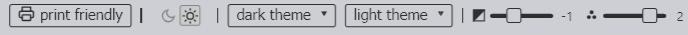
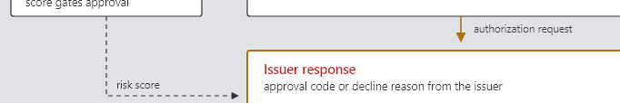
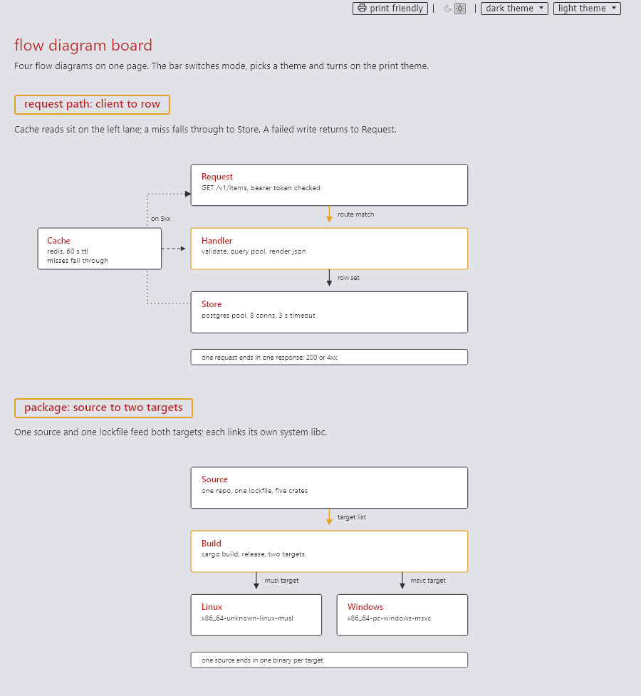
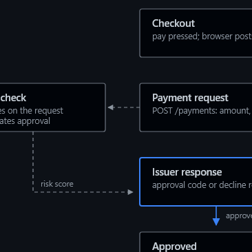
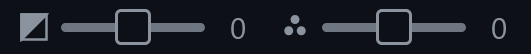

# simpleflow diagram

An agent skill that turns a process into a flow diagram on one HTML page. The layout, the toolbar, 5 dark and 4 light themes plus print-friendly mode come ready-made in the template, so a run writes only the cards and captions. Seven themes start from a well-known programmer scheme and two are custom; in every case all the colours are retuned and placed for this page, then checked under colour-vision simulation and edited again. The written copy follows one set of writing rules, carried as its own chapter in the skill: plain professional English, short, ASCII only, no manual line breaks.

- Fast and Cheap: on the same model, freehand takes 4 to 8 times longer, mostly in checks and revisions. The template is read once and copied, so a page adds a few hundred tokens of text and a second diagram needs no extra setup.
- Optional index page: gathers several finished diagrams and documents onto one page in sections by subject, each card a glyph and a name. Demo: [GITHUB INDEX PAGE SIMPLE FLOW SKILL](https://chezhenkie.github.io/simpleflow-diagram-skill/).
- Readable: the type scale, spacing and card grid are tuned for reading, and the palettes for colour-vision impaired readers; dark themes use light grey instead of white text against contrast glare.
- Consistent: one of nine fixed themes and the same grid on every run, so pages from different models match.
- Iterated under test: multiple sub-agent runs in a run, evaluate, compare, edit, repeat loop; the misses became the rules, budgets and checklist lines.
- Token efficient: one main path of up to seven rows, with a fork or side boxes only where needed; a longer flow becomes a second diagram on the same page without reading the template again.
- Switch: light, dark and print friendly are one click away, and the choice carries into linked pages.
- No browser pass: no screenshots, no PDFs, no renders per theme; the agent checks the cards by reading and opens the page once for you.

## Readability and colour vision

- [color-vision impaired theme corrections](https://chezhenkie.github.io/simpleflow-diagram-skill/color-vision-audit-comparison.html)

The direct link to the palette corrections under colour vision simulation.

## Themes - OS mode following

Nine themes ship with the template.

- Dark: github, harbor, solarized, oledblack, ayu.
- Light: vercel, tokyonight, cursor, orng.

## Sample page

Light, dark and print-friendly theming:

[CLICK IMAGES TO GO TO GITHUB INDEX PAGE WITH SAMPLES AND DOCS](https://chezhenkie.github.io/simpleflow-diagram-skill/)

<a href="https://chezhenkie.github.io/simpleflow-diagram-skill/"></a> <a href="https://chezhenkie.github.io/simpleflow-diagram-skill/"></a><br>
<a href="https://chezhenkie.github.io/simpleflow-diagram-skill/"></a> <a href="https://chezhenkie.github.io/simpleflow-diagram-skill/"></a>

## Page controls - Tool Bar

Seven native controls, all keyboard operable: `go back` at the left end follows browser history, using the Navigation API where it exists, a `?via=1` arrival marker for local files in Firefox and `history.length` as the fallback, and greys out when there is no earlier page; `print friendly` previews the printed look and restores the theme when off, the mode switch picks light or dark and follows the OS, `dark theme` and `light theme` open a menu where each mode keeps its own pick, and brightness and saturation shift the current theme in seven steps each. The sliders leave the saved theme pick alone. On a phone the bar wraps to two rows, the controls first and the sliders second; the print and back labels and the dividers drop away.

<br>
<br>


The toolbar in dark, in light and with print friendly on.

The sliders in dark, and in light at -1 and +2:

<br>


## Optional index page

An index page lists the diagram pages and documents in a folder. `agent-skill/index.html` is the template; every page gets a link card with a small inline SVG glyph and its name, so the page loads nothing external. Pages and documents sit in sections by subject, each with a boxed heading; a document list splits into groups such as skill files and other docs. Every document table uses the same fixed column rule, so the Document and Covers columns line up down the page. The project index is live at https://chezhenkie.github.io/simpleflow-diagram-skill/.

The toolbar passes the mode and both theme names into every local `.html` link and reads them on load. The link carries names, not colours, and each page resolves them through its own theme table, so a project can tune its palette while the linked pages stay in sync by name. A page opened from the index keeps the theme; print stays a preview and does not travel. A user change rewrites the current history entry and keeps the arrival marker, so Back and a reload keep the pick. Nothing is stored.

The skill is five files. A diagram page copied from an older template still works but ignores the query until its toolbar script is updated.

<hr>
<hr>
<hr>

## Install

The skill is five files in `agent-skill/`. Download the zip from the [latest release](https://github.com/chezhenkie/simpleflow-diagram-skill/releases/latest) and unpack it, or clone the repository:

```sh
git clone https://github.com/chezhenkie/simpleflow-diagram-skill.git
```

The release zip and the clone hold the same files; the zip unpacks to `simpleflow-diagram-skill-<version>/`.

| Agent | All projects | One project |
|---|---|---|
| OpenCode | `~/.config/opencode/skills` | `.opencode/skills` |
| Codex | `~/.agents/skills` | `.agents/skills` |
| Pi | `~/.pi/agent/skills` | `.pi/skills` |
| OMP | `~/.omp/agent/skills` | `.omp/skills` |

Copy `agent-skill` into the path from the table as `simpleflow`; in the clone the source is `simpleflow-diagram-skill/agent-skill`. The folder name must match the `name` in `SKILL.md`. `~` is your home directory. If your shell does not expand it, use the full path.

Codex scans `.agents/skills` from the current folder up to the repository root. Pi and OMP scan one level under `skills/`. Restart the agent if the skill does not appear.

## Use

Ask for a flow diagram in this style. The agent reads `agent-skill/SKILL.md`, copies `agent-skill/template.html`, fills the copy and inserts one section per diagram. The diagram body in `agent-skill/style-manual.md` section 10 is the starting block.

For an index of several pages and documents, the agent copies `agent-skill/index.html` and fills the page sections and the document tables; manual section 14 covers the glyph rules, the group split and the budgets.

### Call the skill

| Agent | Invocation |
|---|---|
| OpenCode | `@simpleflow` |
| Codex | `$simpleflow` |
| Pi | `/skill:simpleflow` |
| OMP | `/skill:simpleflow` |

Codex also lists installed skills with `/skills`.

Example request: `Draw the request path as a flow diagram in the house style.`

## Files

| File | Purpose |
|---|---|
| `agent-skill/SKILL.md` | Agent entry point, writing rules, workflow and hard rules |
| `agent-skill/template.html` | Starting page to copy; marked space for the diagram |
| `agent-skill/index.html` | Starting page for an index; sectioned groups of link cards and document tables |
| `agent-skill/demo.html` | Filled reference page: card payment flow with a side channel, a split and a return |
| `agent-skill/style-manual.md` | Theme rules, grid, type scale, card anatomy, connectors, validation |
| `testing-tools/` | Static checks, page validator and toolbar test |
| `docs/` | GitHub Pages index, demo copy and screenshots |
| `CHANGELOG.md` | Version history |

## Check

Run from the repo root:

```sh
python testing-tools/check.py
```

The script checks ASCII and LF endings, the theme table, SVG geometry, that the template and demo agree, the page validator on the demo, and the toolbar script. Python 3 and Node are required.

## Limits

- One main path per diagram, up to seven rows. A decision may fork into two cards on one row. Split longer flows into sections.
- One theme per page and no colors of the agent's own. The reader picks from nine installed themes. The choice travels in the links, so an index and its pages open on the same one.
- ASCII only, inline SVG, no external assets.
- Text budgets are fixed; cut text or split the step when it does not fit.
- An index lists pages; it is not a dashboard and carries no counts or status.

## License

MIT
