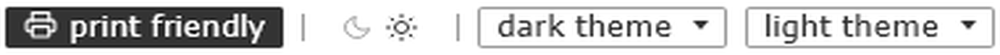

# Simple flow diagram

An agent skill that turns a process into a flow diagram on one HTML page, built for minimal token use and fast generation. Layout, nine themes, the light and dark switch and the print view live in the template, so the agent writes the cards and the captions and nothing else. Any model can place boxes and arrows; the point here is a consistent result at the smallest possible token cost.

Readability is the first principle. The nine themes start from well-known programmer palettes, then text, border, muted, accent and the section outline are tuned until each one reads in light, dark and print. The light themes take the most care, because a bright page is where glare shows: the page sits on a light grey instead of white, the ink is darkened against it, and the title box is an outline rather than a block of colour. The palette is fixed, so a page cannot drift from it.

## Themes

Nine themes ship in the template: five dark and four light. Dark: github, monochrome, ayu, nightowl, solarized. Light: vercel, tokyonight, cursor, orng. The page opens on github or vercel from the OS preference, and the two foldouts switch names, each mode keeping its own pick. Every color on the page comes from the chosen theme, so a diagram carries no palette of its own.

## Cost and speed

- Token use: the page shell, the theme table, the bar script and the print rules are copied as they are. New text per page is the title, the subtitle, the diagrams and the footer; a one-diagram page is a few hundred tokens.
- Speed: no colour choice, no CSS, no layout decisions and no second pass. One pass produces a finished page.
- Consistency: every run uses the same grid and one of nine fixed themes, so pages from different models look the same.
- Scope: one self-contained file that opens from disk, with no build step, network access or assets.

## Samples

Click a sample to open the full-size PNG. The samples show the whole page, footer included.

| Light | Dark | Print friendly |
|:---:|:---:|:---:|
| [](docs/demo-light.png) | [](docs/demo-dark.png) | [](docs/demo-print-friendly.png) |
| Demo, vercel light | Same page, github dark | White page, print tokens |

<table>
  <tr>
    <td><a href="https://chezhenkie.github.io/simple-flow-diagram-skill/">CLICK HERE TO OPEN THE LIVE, GITHUB-HOSTED DEMO PAGE</a></td>
  </tr>
</table>

## Page controls

Four controls sit at the top right. All are native buttons and work with Tab, Enter and Space.

`print friendly` previews the paper theme on screen: white page, black text and the print tokens on every diagram. The bar is hidden in the browser print preview. Switching it off restores the mode that was active before.

The mode switch selects light or dark. The page starts from the OS preference and follows OS changes until the switch is clicked.

`dark theme` and `light theme` open a foldout with five dark names or four light names. Dark: github, monochrome, ayu, nightowl, solarized. Light: vercel, tokyonight, cursor, orng. Picking a name applies it to the page and every diagram on it, and switches to that mode. Each mode keeps its own pick, so the switch flips between the two.


Dark mode: github theme, print off.


Light mode: vercel theme, print off.



Print friendly on: the print control fills, the mode and theme stay unchanged.

## Install

The skill payload is in `agent-skill/`. Clone the repository, then copy that folder into the skills folder for your agent and name the copy `simple-flow-diagram-skill`. The folder name must match the `name` in `SKILL.md`.

```sh
git clone https://github.com/chezhenkie/simple-flow-diagram-skill.git
```

| Agent | All projects | One project |
|---|---|---|
| OpenCode | `~/.config/opencode/skills` | `.opencode/skills` |
| Codex | `~/.agents/skills` | `.agents/skills` |
| Pi | `~/.pi/agent/skills` | `.pi/skills` |
| OMP | `~/.omp/agent/skills` | `.omp/skills` |

Copy `simple-flow-diagram-skill/agent-skill` to the path from the table as `simple-flow-diagram-skill`. `~` is your home directory. If your shell does not expand it, use the full path.

Codex scans `.agents/skills` from the current folder up to the repository root. Pi and OMP scan one level under `skills/`. Restart the agent if the skill does not appear.

## Use

Ask for a flow diagram in this style. The agent reads `agent-skill/SKILL.md`, copies `agent-skill/template.html`, fills the page copy and inserts one section per diagram. The diagram body in `agent-skill/style-manual.md` section 10 is the starting block.

### Call the skill

| Agent | Invocation |
|---|---|
| OpenCode | `@simple-flow-diagram-skill` |
| Codex | `$simple-flow-diagram-skill` |
| Pi | `/skill:simple-flow-diagram-skill` |
| OMP | `/skill:simple-flow-diagram-skill` |

Codex also lists installed skills with `/skills`.

Example request: `Draw the request path as a flow diagram in the house style.`

## Files

| File | Purpose |
|---|---|
| `agent-skill/SKILL.md` | Agent entry point, workflow and hard rules |
| `agent-skill/template.html` | Page shell to copy; marked diagram slot |
| `agent-skill/demo.html` | Filled reference page: card payment flow with a side channel, a split and a return |
| `agent-skill/style-manual.md` | Theme rules, grid, type scale, card anatomy, connectors, validation |
| `agent-skill/validate.py` | Page validator, run on the finished page |
| `testing-tools/` | Static and bar behavior checks |
| `docs/` | Screenshots and the GitHub Pages entry |
| `CHANGELOG.md` | Version history |

## Check

Run from the repo root:

```sh
python testing-tools/check.py
```

The script validates ASCII and LF endings, the theme table, SVG geometry, template and demo parity, and the bar state machine. Python 3 and Node are required.

## Limits

- One main path per diagram, up to seven cards. A decision may fork into two cards on one row. Split longer flows into sections.
- One theme per page and no colors of the agent's own. The reader picks from nine installed themes.
- ASCII only, inline SVG, no external assets.
- Text budgets are fixed; cut text or split the step when it does not fit.

## License

MIT
