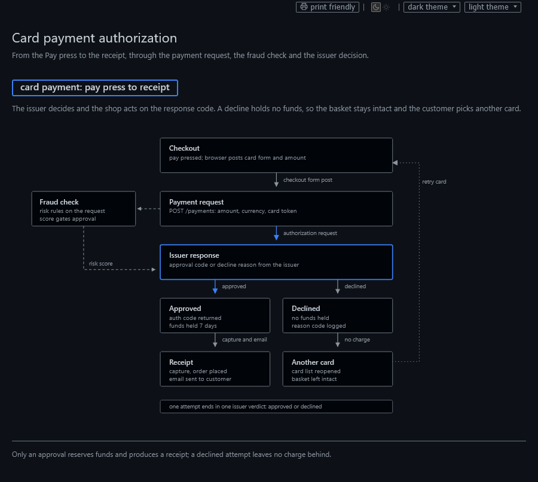
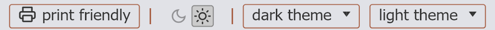

# simpleflow diagram

An agent skill that turns a process into a flow diagram on one HTML page. The layout, nine themes, light and dark, print and the toolbar come ready-made in the template, so a run writes only the cards and captions.

- Fast: one diagram in under two minutes, a dozen to fifteen turns.
- Cheap: the template is read once and copied, so a page adds a few hundred tokens of new text and a second diagram needs no extra setup.
- Readable: the type scale, spacing and card grid are tuned for reading, the palettes are retuned for colour-vision impaired readers, and the light themes use a soft background to avoid glare.
- Consistent: one of nine fixed themes and the same grid on every run, so pages from different models match.
- Token efficient: one main path per diagram, up to seven rows, with a fork or side boxes only where needed. The cap keeps the output small, and a longer flow becomes a second diagram on the same page without reading the template again.
- Switch: light, dark and print friendly are one click away, and the choice carries into linked pages.
- No browser pass: no screenshots, no PDFs, no renders per theme. The agent checks the written cards by reading and opens the page once for you.

An index page gathers several finished diagrams and documents onto one page.

## Readability and colour vision

- [Colour vision audit](https://chezhenkie.github.io/simpleflow-diagram-skill/color-vision-audit.html)
- [color-vision impaired theme corrections](https://chezhenkie.github.io/simpleflow-diagram-skill/color-vision-audit-comparison.html)

These are direct GitHub links to the two colour vision and readability documents.

## Themes

Nine themes ship with the template.

- Dark: github, harbor, solarized, oledblack, ayu.
- Light: vercel, tokyonight, cursor, orng.

The page opens in the OS light or dark mode and follows it until the mode switch is used. Each menu switches theme, and each mode keeps its own choice, so the switch flips between the two. Every color on the page comes from the chosen theme, so a diagram carries no palette of its own.

## Sample page

Light, dark and print-friendly theming:

[CLICK IMAGES TO GO TO GITHUB INDEX PAGE WITH SAMPLES AND DOCS](https://chezhenkie.github.io/simpleflow-diagram-skill/)

<a href="https://chezhenkie.github.io/simpleflow-diagram-skill/"></a> <a href="https://chezhenkie.github.io/simpleflow-diagram-skill/"></a><br>
<a href="https://chezhenkie.github.io/simpleflow-diagram-skill/"></a> <a href="https://chezhenkie.github.io/simpleflow-diagram-skill/"></a>

## Page controls

Four controls sit at the top right. All are native buttons and work with Tab, Enter and Space.

`print friendly` previews the printed look on screen: white page, black text and the print colors on every diagram. The toolbar is hidden in the browser print preview. Switching it off restores the theme that was active before.

The mode switch selects light or dark. The page starts from the OS preference and follows OS changes until the switch is clicked.

`dark theme` and `light theme` open a menu with five dark names or four light names. Dark: github, harbor, solarized, oledblack, ayu. Light: vercel, tokyonight, cursor, orng. Picking a name applies it to the page and every diagram on it, and switches to that mode. Each mode keeps its own choice, so the switch flips between the two.


Dark mode: github theme, print off.



Light mode: vercel theme, print off.


Print friendly on: the print control fills, the mode and theme stay unchanged.

## Several pages

Several diagram pages and text documents can sit on one index page. `agent-skill/index.html` provides it: a title, one or more groups of link cards, and an optional table of documents. Each card carries a small inline SVG glyph, so the index loads no assets either. The project index is live at https://chezhenkie.github.io/simpleflow-diagram-skill/.

The toolbar passes the mode and both theme choices into every local `.html` link and reads them on load. A page opened from the index keeps the theme; print stays a preview and does not travel. Nothing is stored.

The skill is five files. A diagram page copied from an older template still works but ignores the query until its toolbar script is updated.

## Install

The skill is five files in `agent-skill/`. Clone the repository, then copy that folder into the skills folder for your agent and name the copy `simpleflow`. The folder name must match the `name` in `SKILL.md`.

```sh
git clone https://github.com/chezhenkie/simpleflow-diagram-skill.git
```

| Agent | All projects | One project |
|---|---|---|
| OpenCode | `~/.config/opencode/skills` | `.opencode/skills` |
| Codex | `~/.agents/skills` | `.agents/skills` |
| Pi | `~/.pi/agent/skills` | `.pi/skills` |
| OMP | `~/.omp/agent/skills` | `.omp/skills` |

Copy `simpleflow-diagram-skill/agent-skill` to the path from the table as `simpleflow`. `~` is your home directory. If your shell does not expand it, use the full path.

Codex scans `.agents/skills` from the current folder up to the repository root. Pi and OMP scan one level under `skills/`. Restart the agent if the skill does not appear.

## Use

Ask for a flow diagram in this style. The agent reads `agent-skill/SKILL.md`, copies `agent-skill/template.html`, fills the copy and inserts one section per diagram. The diagram body in `agent-skill/style-manual.md` section 10 is the starting block.

For an index of several pages and documents, the agent copies `agent-skill/index.html` and fills the link cards and the documents table; manual section 14 covers the glyph rules and the budgets.

### Call the skill

| Agent | Invocation |
|---|---|
| OpenCode | `@simpleflow` |
| Codex | `$simpleflow` |
| Pi | `/skill:simpleflow` |
| OMP | `/skill:simpleflow` |

Codex also lists installed skills with `/skills`.

Example request: `Draw the request path as a flow diagram in the house style.`

## Files

| File | Purpose |
|---|---|
| `agent-skill/SKILL.md` | Agent entry point, workflow and hard rules |
| `agent-skill/template.html` | Starting page to copy; marked space for the diagram |
| `agent-skill/index.html` | Starting page for an index; link cards with inline glyphs and a documents table |
| `agent-skill/demo.html` | Filled reference page: card payment flow with a side channel, a split and a return |
| `agent-skill/style-manual.md` | Theme rules, grid, type scale, card anatomy, connectors, validation |
| `testing-tools/` | Static checks, page validator and toolbar test |
| `docs/` | GitHub Pages index, demo copy and screenshots |
| `color-vision-audit.md` | Colour vision audit of the nine themes |
| `CHANGELOG.md` | Version history |

## Check

Run from the repo root:

```sh
python testing-tools/check.py
```

The script checks ASCII and LF endings, the theme table, SVG geometry, that the template and demo agree, the page validator on the demo, and the toolbar script. Python 3 and Node are required.

## Limits

- One main path per diagram, up to seven rows. A decision may fork into two cards on one row. Split longer flows into sections.
- One theme per page and no colors of the agent's own. The reader picks from nine installed themes. The choice travels in the links, so an index and its pages open on the same one.
- ASCII only, inline SVG, no external assets.
- Text budgets are fixed; cut text or split the step when it does not fit.
- An index lists pages; it is not a dashboard and carries no counts or status.

## License

MIT
