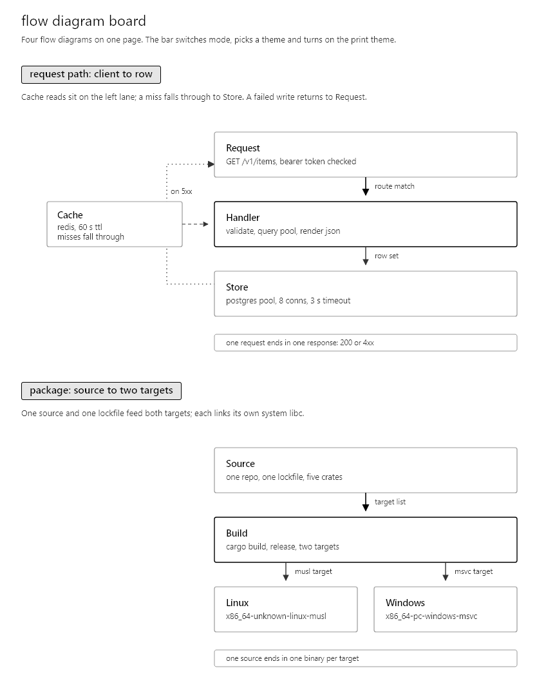

# Simple flow diagram

Flow diagrams as one standalone HTML file. One vertical main path, optional side channels, muted palette pairs, a fixed top bar, light and dark themes and a print theme. No external CSS, fonts, scripts or images. The file opens from `file://`.

## Samples

Click a sample to open the full-size PNG.

| Light | Dark | Print friendly |
|:---:|:---:|:---:|
| [](docs/demo-light.png) | [](docs/demo-dark.png) | [](docs/demo-print-friendly.png) |
| Three flows, one page background | Same layout, dark palette pairs | White page, print palette |

## Page controls

Two controls sit at the top right. Both are native buttons and work with Tab, Enter and Space.

`print friendly` previews the paper theme on screen: white page, black text and the print palette on every diagram. The bar is hidden in the browser print preview. Switching it off restores the mode that was active before.

The mode switch selects light or dark. The page starts from the OS preference and follows OS changes until the switch is clicked.


Dark mode: moon selected, print off.


Light mode: sun selected, print off.


Print friendly on: the print control fills, the light/dark selection stays unchanged.

## Files

| File | Purpose |
|---|---|
| `SKILL.md` | Agent entry point, workflow and hard rules |
| `template.html` | Page shell to copy; marked diagram slot |
| `demo.html` | Filled reference page with three diagrams |
| `references/style-manual.md` | Grid, type scale, card anatomy, connectors, validation |
| `references/palettes.html` | Palette catalog for both modes and print |
| `tests/` | Static and bar behavior checks |
| `CHANGELOG.md` | Version history |

## Install

Copy or clone the repository into an agent skills directory as `simple-flow-diagram-skill`. The folder name must match the skill name.

OpenCode global skills: `~/.config/opencode/skills/simple-flow-diagram-skill`

OpenCode project skills: `.opencode/skills/simple-flow-diagram-skill`

## Use

Ask for a flow diagram in this style. The agent reads `SKILL.md`, copies `template.html`, fills the page copy and inserts one section per diagram. The diagram body in `references/style-manual.md` section 10 is the starting block.

Example request: `Draw the request path as a flow diagram in the house style.`

## Check

Run from the repo root:

```sh
python tests/check.py
```

The script validates ASCII and LF endings, palette tokens, SVG geometry, template and demo parity, and the bar state machine. Python 3 and Node are required.

## Limits

- One main path per diagram, up to seven cards. Split longer flows into sections.
- Light mode uses light palettes; dark mode uses dark palettes. Mix pairs for contrast.
- ASCII only, inline SVG, no external assets.
- Text budgets are fixed; cut text or split the step when it does not fit.

## License

MIT
